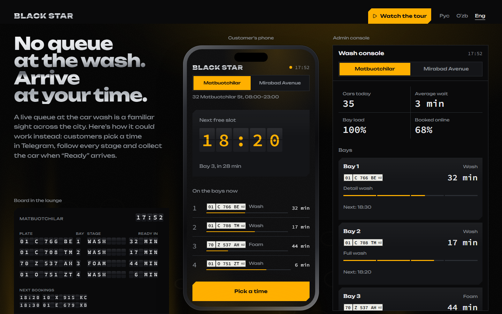
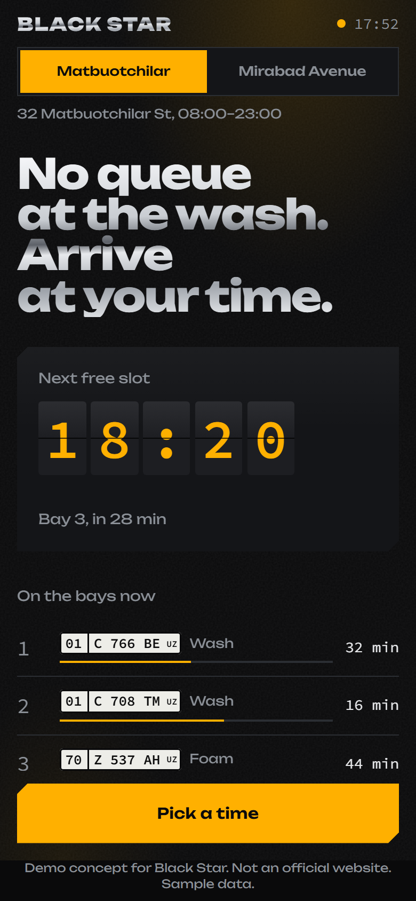
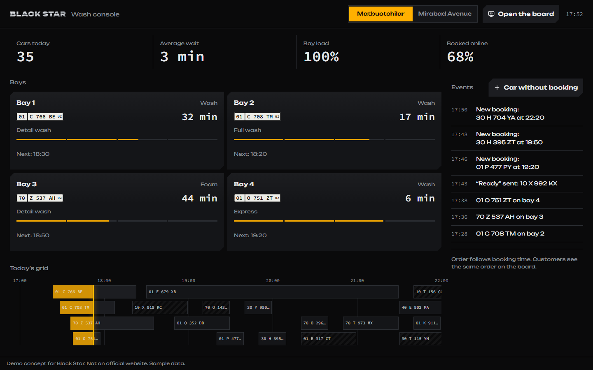
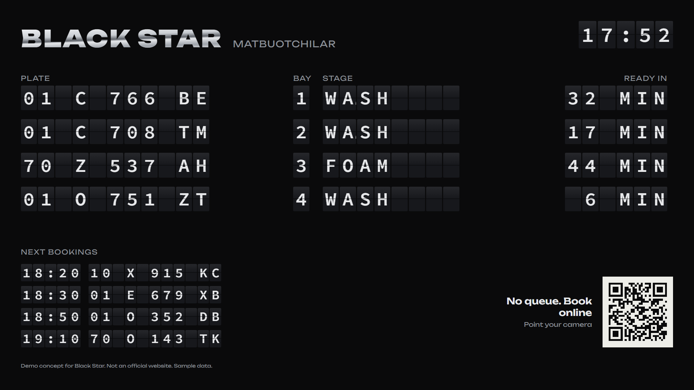

# Studio Demo Engine

**One Next.js codebase that turns a local business into a working, branded demo app in a few minutes — built to pitch software to business owners in Uzbekistan.**

- **Live demo (Black Star car wash, auto-tour):** https://dela-beige.vercel.app/demo/black-star?tour=1
- **Video of the auto-tour (45 s):** [docs/media/tour.webm](docs/media/tour.webm)

| Pitch page | Customer app (phone) |
|---|---|
|  |  |

| Owner panel | TV board in the lounge |
|---|---|
|  |  |

## What it is and why

Small businesses here (car washes, clinics, salons, restaurants) still run on phone calls and live queues. Instead of describing an app to an owner, I wanted to send one link that shows *their* business already working: their name, colours and branches, a customer app, an owner panel and a TV board — all live and in sync.

Each demo link contains:

- **Pitch page** — the problem and the solution in one screen, with the live app embedded.
- **Customer app** — e.g. booking a car-wash slot and following the car through each stage. Also runs as a **Telegram Mini App**.
- **Owner panel** — bays, load, bookings and an event feed.
- **TV board** — a split-flap queue board for the waiting room.
- **Auto-tour** (`?tour=1`) — a ~35-second ghost cursor clicks through the real interface, so an owner understands it without a call.
- **Three languages** — Russian, Uzbek (Latin) and English.

The simulation is deterministic and accelerated (1 demo minute = 10 seconds), so every tab and every reload shows the same state; tabs stay in sync through `BroadcastChannel`.

Black Star is fully built; four more brands (Darel, Doctor Vet, Expert Beauty, Mr. Gordon's) have theme, copy and data and use a placeholder scenario. All are unsolicited concept demos: the studio is not affiliated with these companies, and every page says so.

## Tech stack

Next.js 16 (App Router, static generation) · React 19 · TypeScript · Tailwind CSS 4 (classes generated from each brand's theme tokens) · next-intl · Zustand · Motion · OGL (WebGL background) · Telegram Mini App API · Playwright (screenshots and end-to-end flows) · Vercel.

## Run locally

Requires Node.js 20.9+.

```bash
npm install
npm run dev
```

Open http://localhost:3000/demo/black-star (add `?tour=1` for the auto-tour, `?lang=en` for English).

Production build: `npm run build && npm start`. Regenerate the README screenshots and video: `npx playwright install chromium`, then `node scripts/readme-media.mts` against a running production server.

## My role

I used AI coding tools heavily — mostly **Claude Code**. The `.claude/` folder and `AGENTS.md` are its working files. What I did myself:

- **Product:** chose the niches and businesses, defined what each demo must show an owner, and wrote the scenarios (customer flow, owner panel, board, auto-tour).
- **Directing the AI:** broke the work into tasks, wrote the specifications and the rules the code had to follow (theming, honest disclaimers, Uzbek typography, performance budget).
- **Review:** checked the screens at phone and desktop sizes, compared screenshots before and after each change, and sent work back when it was wrong; the `review/` folder holds those screenshots.
- **Go-to-market:** found the businesses and sent them the demos.

I can explain how every part works — the brand theme system, the deterministic simulation, the tour engine, the Telegram integration — even where the first draft of the code was written by AI.

## What I learned

- **Distribution was the bottleneck, not the product.** I sent about 100 offers with demo links; none turned into a sale. They were cold messages to owners I had no connection with, and most never replied or didn't read past the first lines — so the demos mostly weren't even opened.
- **Validate demand before building.** I built the product before talking to customers. A few conversations first would have shown that getting attention was the real problem.
- **AI makes building cheap, which makes judgment the scarce part.** The hard work was deciding what to build, describing it precisely and catching what was wrong — not typing the code.

---

# Демо-движок студии

Один Next.js-проект, пять брендированных демо. Каждое демо — отдельная ссылка для владельца бизнеса: страница-презентация с живым приложением, панелью владельца и авто-туром.

| Ссылка | Что это |
|---|---|
| `/` | Внутренняя витрина студии: все демо, ссылки, «скопировать ссылку» |
| `/demo/<slug>` | Презентация для владельца. На телефоне — приложение во весь экран с переключателем «Клиент / Владелец» |
| `/demo/<slug>?tour=1` | Авто-тур ~35 секунд: курсор-призрак сам проходит сценарий |
| `/demo/<slug>?lang=uz` | То же на узбекском (или `en`). Язык запоминается в cookie |
| `/demo/<slug>/app` | Клиентское приложение, работает и как Telegram Mini App |
| `/demo/<slug>/admin` | Панель владельца или администратора |
| `/demo/<slug>/board` | ТВ-табло очереди (только у брендов с модулем `queue`) |
| `/styleguide` | Токены и компоненты всех тем |

Готово: **Black Star** (`black-star`). Остальные бренды уже имеют тему, тексты и данные, их сценарии добавляются по мере ответов владельцев.

## Стек

- **Next.js 16** (App Router, статическая генерация страниц демо) + **React 19**, **TypeScript**
- **Tailwind CSS 4** — классы строятся из темы бренда, стандартная палитра выключена
- **next-intl** — три языка: русский, узбекский (латиница), английский
- **Zustand** — стор живой симуляции, синхронизация вкладок через BroadcastChannel
- **Motion** — анимации и авто-тур, **OGL** — WebGL-фон, **lucide-react** — иконки, **uqr** — QR-коды
- **Telegram Mini App** — клиентское приложение открывается внутри Telegram
- **Playwright** — скриншоты и сквозные сценарии в `scripts/`
- Деплой — **Vercel**

## Запуск

Нужен Node.js 20.9+.

```bash
npm install
npm run dev
```

Откройте http://localhost:3000.

Прод-сборка локально:

```bash
npm run build
npm start
```

### Переменные окружения

| Переменная | Зачем |
|---|---|
| `NEXT_PUBLIC_CONTACT_TG` | Куда ведёт «Обсудить внедрение»: `@username`, `username` или полный URL. Без неё стоит плейсхолдер |
| `NEXT_PUBLIC_SITE_URL` | Абсолютный адрес сайта для OG-картинок и QR на табло. На Vercel не нужен — берётся `VERCEL_PROJECT_PRODUCTION_URL` |
| `TELEGRAM_BOT_TOKEN` | (фаза 6) Включает кнопку «Получить тестовое напоминание в Telegram» |

## Как устроено

```
brands/                 конфиги брендов — данные, тексты ru/uz/en, тема
messages/{ru,uz,en}.json строки движка (кнопки тура, плашка, единицы)
src/
  app/[locale]/…        маршруты; язык в URL не виден (src/proxy.ts переписывает запрос)
  engine/               тема, стор, симуляция, тур, адаптер Telegram
  modules/              логика модулей: queue, booking, crm, leads…
  skins/<slug>/         «душа» бренда: экраны, вау-компоненты, тур, OG
  ui/                   общие примитивы без характера бренда
scripts/                скриншоты, сквозные сценарии, Lighthouse
review/                 скриншоты визуальной самопроверки (до/после)
```

- **Тема** — `brands/<slug>.ts → theme`. Это не только цвета: шрифты, радиусы, линии, тени, кривые движения, толщина иконок. Превращается в CSS-переменные (`--c-bg`, `--f-display`, `--r-m`…) и в Tailwind-классы (`bg-bg`, `text-accent`, `font-display`, `rounded-m`). Стандартная палитра Tailwind выключена.
- **Характер компонентов** — `src/skins/<slug>/skin.css`: форма кнопок (`--btn-clip`, `--btn-shadow`), чипов, нажатий.
- **Живая симуляция** — модель бренда (`src/skins/<slug>/model.ts`) детерминирована: одинаковое состояние у всех вкладок и после перезагрузки. Часы демо идут ускоренно (1 минута демо = 10 секунд). Стор пишет в localStorage и синхронизирует вкладки через BroadcastChannel; симуляцию двигает одна вкладка-лидер (Web Locks). Без этих API демо работает в памяти.
- **Тур** — `src/skins/<slug>/tour.ts`: список шагов (`caption`, `tap`, `point`, `view`, `until`). Курсор нажимает настоящие кнопки с атрибутом `data-tour`, поэтому тур не может разойтись с приложением. Любое касание пользователя ставит тур на паузу.
- **Шрифты** — `src/engine/theme/fonts.ts`, через `next/font`, только latin + cyrillic. Каждый шрифт проверен на кириллицу и узбекскую `ʻ` (U+02BB). Файлы шрифта скачиваются только на страницах бренда, который их использует.

## Как добавить новый бренд за 15 минут

1. **Конфиг.** Скопируйте `brands/darel.ts` в `brands/<slug>.ts` и замените:
   - `slug`, `name` (текстовый вордмарк — без чужих логотипов), `niche`;
   - `theme`: цвета, `font` (ключи из `FontKey`), радиусы, движение. Нужен новый шрифт — добавьте его в `src/engine/theme/fonts.ts` и проверьте на кириллицу и `ʻ`;
   - `pitch.headline` и `pitch.lede` — проблема и решение одним предложением, без упрёков владельцу;
   - `branches` (реальные адреса — только из публичных источников), `services`, `staff`, `effects` (всегда прогноз);
   - `copy.ru / uz / en`. Узбекский — латиница, `oʻ gʻ` через `ʻ`; пометьте `// TODO: проверить носителем`.
2. **Реестр.** Добавьте строку в `brands/index.ts`.
3. **Скин.** В `src/skins/index.ts` укажите `() => import("./placeholder")` — демо сразу заработает в теме бренда. Для полноценного сценария скопируйте `src/skins/black-star/` и замените экраны, модель и тур.
4. **Вордмарк.** Добавьте `case` в `src/skins/wordmark.tsx`.
5. **Проверка.** `npm run build`, затем `node scripts/shoot.mts --label <slug>`.

## Проверки

```bash
node scripts/shoot.mts --label review-1
```

Скриншоты 390×844, 1440×900, 1920×1080 сохраняются в `review/review-1/`.

```bash
node scripts/flow.mts --cpu 4
```

Сквозной сценарий клиента на телефоне при CPU, замедленном в 4 раза.

```bash
node scripts/tour.mts --width 390 --cpu 4
```

Авто-тур, кадр каждые 4 секунды.

```bash
node scripts/lighthouse.mts
```

Lighthouse mobile. Запускайте на прод-сервере (`npm run build && npm start`).

Перед первым запуском скриптов поставьте браузер для Playwright: `npx playwright install chromium`.

## Деплой на Vercel

1. Залейте репозиторий на GitHub и импортируйте его в Vercel (Framework: Next.js, всё по умолчанию). Или из терминала: `npx vercel` → `npx vercel --prod`.
2. В Settings → Environment Variables задайте `NEXT_PUBLIC_CONTACT_TG`.
3. Свой домен — Settings → Domains. После смены домена пересоберите проект, чтобы OG-картинки и QR получили новый адрес.

Индексация закрыта трижды: `robots.txt`, `<meta name="robots">` и заголовок `X-Robots-Tag`. Ботам превью ссылок (Telegram, Instagram, WhatsApp) доступ открыт, иначе вместо картинки будет пустая карточка.

### Превью ссылки в Telegram

Telegram кэширует превью ссылок. Если OG-картинка или заголовок изменились после первой отправки ссылки, обновите превью: напишите [@WebpageBot](https://t.me/WebpageBot) и отправьте ему ссылку на демо — он перечитает страницу.

### Telegram Mini App

1. В [@BotFather](https://t.me/BotFather): `/newbot` → `/newapp` (или Bot Settings → Configure Mini App) → URL: `https://<домен>/demo/<slug>/app`.
2. Внутри Telegram приложение красит шапку и фон в цвет бренда, использует нативные MainButton и BackButton и вибрацию. В обычном браузере те же экраны работают с собственными кнопками.

## Честность демо

- Это концепт-шаблоны студии, сделанные по своей инициативе. Компании их не заказывали, студия с ними не связана, названия принадлежат владельцам.
- Название компании — текстовый вордмарк, без логотипа. Black Star — без звезды.
- Внизу каждой страницы: «Демо-концепт для <Компания>. Не официальный сайт. Данные примерные».
- Цены, мастера, врачи, расписания — примерные и лежат в конфиге. Адреса — из публичных карточек на картах.
- Цифры эффектов подписаны как прогноз.
- В текстах не цитируем отзывы и не делаем проблему виной владельца: показываем, как может быть.
